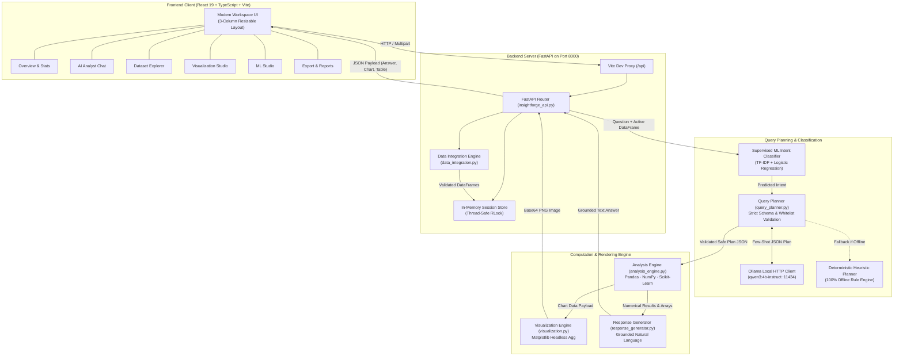
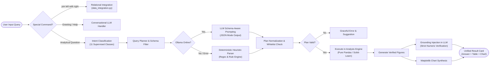
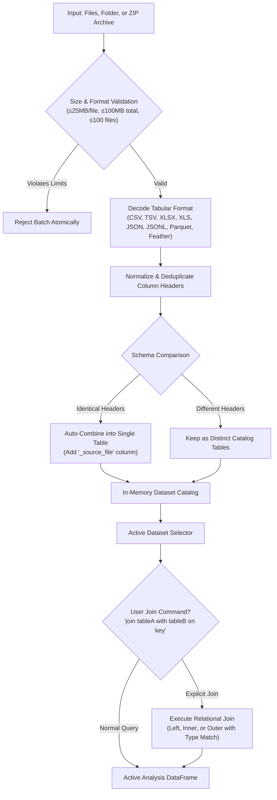

# InsightForge AI

<div align="center">


<br/>

[](https://www.python.org/)
[](https://react.dev/)
[](https://www.typescriptlang.org/)
[](https://fastapi.tiangolo.com/)
[](https://vitejs.dev/)
[](https://ollama.ai/)
[](https://pandas.pydata.org/)
[](https://scikit-learn.org/)
[](#license)

**A private, local-first conversational AI data analyst and machine learning workspace.**  
*Structured KDD Methodology · Deterministic Anti-Hallucination Engine · Dual React + FastAPI & Gradio Architectures*

[Key Features](#key-features) • [System Architecture](#system-architecture) • [Working Flowcharts](#working-flowcharts) • [Workspaces](#dedicated-workspaces) • [Quick Start](#quick-start) • [API Routes](#local-api-routes) • [Evaluation](#evaluation--benchmarks)

</div>

---

## Overview

**InsightForge AI** is an intelligent tabular data analysis agent and workspace designed to deliver the analytical power of a data science team right on your local machine. Built on the classical **KDD (Knowledge Discovery in Databases)** process, InsightForge transforms raw CSV, Excel, JSON, Parquet, and Feather files into actionable insights, publication-ready visualizations, and predictive models through natural language interaction.

### Why InsightForge AI?

1. **100% Local & Privacy-Preserving:** Powered by local LLMs via **Ollama** (`qwen3:4b-instruct`). No proprietary data leaves your machine; zero cloud API fees.
2. **Deterministic Anti-Hallucination Architecture:** The LLM is used **strictly for query planning and conversational explanation**. It is **never** permitted to generate or execute arbitrary Python code (`no eval()/exec()`). All statistical figures, aggregations, and ML metrics originate directly from verified Pandas, NumPy, and Scikit-Learn computations.
3. **Graceful Deterministic Fallback:** If Ollama is offline or unavailable, the built-in rule-based heuristic planner automatically handles queries across all 5 KDD stages with 100% uptime.
4. **Multi-Dataset Ingestion & Relational Joins:** Ingest single tables, multi-sheet workbooks, directories, and ZIP archives. Automatically append matching tables with provenance tracking or join related tables using natural language or explicit keys.
5. **Modern Three-Column Workspace:** Built with React 19, TypeScript, and Vite, featuring resizable panels, an interactive Visualization Studio, and one-click quick question prompts.

---

## Working Flowcharts

### 1. End-to-End System Architecture

The following diagram illustrates the complete runtime data flow from user interaction to local LLM planning, deterministic execution, and visualization delivery:



---

### 2. Query Execution & Anti-Hallucination Pipeline

InsightForge enforces a strict separation between linguistic comprehension and mathematical calculation to prevent LLM hallucinations:



---

### 3. The 5-Stage KDD Analytical Workflow

The analysis engine is built around the 5 standard stages of Knowledge Discovery in Databases:

```mermaid
flowchart TD
    subgraph KDD1["Stage 1: Selection & Inspection"]
        S1["Row/Column Filtering"]
        S2["Data Profiling & Dtype Inference"]
        S3["Memory Footprint & Constant Detection"]
        S4["Top N / Bottom N & Slicing"]
    end

    subgraph KDD2["Stage 2: Preprocessing & Cleaning"]
        P1["Missing Value Imputation (Mean, Median, Mode, FFill)"]
        P2["Duplicate Row Purging"]
        P3["IQR Outlier Detection & Capping"]
        P4["Whitespace Trimming & Type Coercion"]
    end

    subgraph KDD3["Stage 3: Transformation & Feature Engineering"]
        T1["Scaling (StandardScaler, MinMax, Robust)"]
        T2["Log Transformations & Quantile Binning"]
        T3["One-Hot & Categorical Label Encoding"]
        T4["Domain Features (Age Groups, Family Size, Alone)"]
        T5["Group Aggregations & Pivot Tables"]
    end

    subgraph KDD4["Stage 4: Data Mining & Modeling"]
        M1["Pearson & Spearman Correlation Matrices"]
        M2["Unsupervised Clustering (K-Means, DBSCAN)"]
        M3["Supervised Classification (Decision Trees, Logistic Regression)"]
        M4["Supervised Regression (Linear Regression)"]
        M5["Dimensionality Reduction (PCA) & Cross-Validation"]
    end

    subgraph KDD5["Stage 5: Interpretation & Reporting"]
        R1["Grounded Conversational Summaries"]
        R2["Visual Representation (Bar, Line, Scatter, Hist, Heatmap)"]
        R3["In-Memory Dataset Mutation Tracking"]
        R4["CSV Modified Dataset Export"]
    end

    KDD1 --> KDD2 --> KDD3 --> KDD4 --> KDD5
```



---

### 4. Multi-Dataset Integration & Ingestion Flow



---

## Key Features

### 1. Robust Tabular Data Ingestion
- **Extensive Format Support:** CSV, TSV, TXT, Excel (`.xlsx`, `.xls`), JSON (records/arrays), JSON Lines (`.jsonl`, `.ndjson`), Apache Parquet, and Feather.
- **In-Memory Archive Reading:** Directly processes ZIP archives in RAM without disk extraction, protecting the host system from zip-bomb and path-traversal attacks.
- **Safety Limits:** Up to 100 files per selection, 25 MB per file, 100 MB total expanded dataset, 1,000,000 rows, and 10,000,000 cells.

### 2. Relational Table Integration
- **Automatic Schema Matching:** Tables with identical headers uploaded together are merged into a combined table with `_source_file` provenance tracking.
- **Conversational & Explicit Relational Joins:** Join tables directly using commands like:
  ```text
  join "orders.csv" with "customers.csv" on customer_id
  inner join "sales.xlsx" with "regions.csv" on region_id
  outer join "q1.csv" with "q2.csv" on product_id, store_id
  ```
- Also available programmatically via `POST /api/integrate`.

### 3. Supervised Machine Learning Intent Classifier
- Classifies user questions into **11 analytical intents** using a Scikit-Learn TF-IDF vectorizer + multinomial Logistic Regression model trained on domain-specific query corpora:
  - `aggregation`, `maximum`, `minimum`, `counting`, `filtering`, `ranking`, `group_comparison`, `trend_analysis`, `visualization`, `data_quality`, `correlation`.

### 4. Zero-Hallucination Execution Engine
- Pure Pandas, NumPy, and Scikit-Learn computation.
- Whitelist validation on all operations and columns before execution.
- LLM response generator receives strictly calculated data frames and values to formulate natural, conversational explanations without altering values.

### 5. Automated Data Visualizations
- Headless **Matplotlib** generation (`matplotlib.use("Agg")`) producing base64-encoded PNG figures.
- Automatic chart recommendation matching analytical task type:
  - **Bar Charts:** Categorical aggregates and Top-N rankings.
  - **Histograms:** Distribution of continuous numerical columns.
  - **Scatter Plots:** Bivariate relationships and correlations.
  - **Line Charts:** Sequential or temporal trends.
  - **Heatmaps & Confusion Matrices:** Correlation matrices and ML diagnostic evaluations.

---

## Dedicated Workspaces

InsightForge v4 features six dedicated workspaces accessible from the sidebar:

| Workspace | Purpose & Capabilities |
| :--- | :--- |
| **📊 Overview** | Dataset summary, row/column counts, memory footprint, missing value counts, duplicate detection, and instant quick-start questions. |
| **💬 AI Analyst** | Multi-turn conversational question-and-answer workspace with rich result cards, chart docks, tabular preview, and follow-up query suggestions. |
| **🗄️ Datasets** | In-depth tabular inspection, per-column datatypes, null statistics, search/filter fields, and active dataset switcher. |
| **📈 Visualization Studio** | Full-width visualization canvas with zoomable chart view, data table inspector, PNG chart export, and a dedicated contextual chat bar. |
| **🧠 ML Studio** | One-click machine learning shortcuts: K-Means clustering, DBSCAN, Decision Tree classification, Logistic Regression, Linear Regression, PCA dimensionality reduction, and model evaluations. |
| **📑 Reports** | Export modified datasets (preserving imputations, scaling, and transformations) as CSV for downstream tools. |

---

## Technology Stack

| Layer | Component | Version / Tech |
| :--- | :--- | :--- |
| **Frontend** | Framework | React 19, TypeScript 5, Vite 6 |
| | UI & Icons | Lucide React, react-markdown, Custom Vanilla CSS |
| **Backend API** | Framework | FastAPI 0.110+, Uvicorn 0.28+, Pydantic v2 |
| | Multipart Handling | python-multipart |
| **AI / NLP** | Local Model | Ollama with `qwen3:4b-instruct` |
| | Intent Classifier | Scikit-Learn (TF-IDF + Logistic Regression) |
| **Analytics & ML** | Computation | Pandas 2.2+, NumPy 1.26+, Scikit-Learn 1.4+ |
| | Tabular Formats | openpyxl, xlrd, pyarrow |
| **Visualization** | Engine | Matplotlib 3.8+ (Headless Agg backend) |
| **Legacy UI** | Optional Interface | Gradio 4.20+ (`app.py`) |

---

## Repository Structure

```text
Ai-Data-Analyst-Agent-ML-Project/
├── frontend/                     # React 19 + TypeScript + Vite Workspace
│   ├── src/
│   │   ├── App.tsx               # Main application layout, workspaces & state
│   │   ├── styles.css            # Responsive themes, panels & layout tokens
│   │   └── main.tsx              # React application DOM entry point
│   ├── package.json              # NPM scripts and frontend dependencies
│   ├── tsconfig.json             # TypeScript compiler settings
│   └── vite.config.ts            # Vite build configuration with /api proxy
│
├── insightforge_api.py           # FastAPI backend server & session coordinator
├── query_classifier.py           # Supervised ML query intent classification model
├── query_planner.py              # LLM schema-aware prompt generator & deterministic fallback
├── analysis_engine.py            # 5-stage KDD analytical execution engine (Pandas/Sklearn)
├── response_generator.py         # Grounded conversational explanation synthesizer
├── visualization.py              # Matplotlib automated chart generation module
├── data_integration.py           # Multi-file tabular ingestion, schema match & joins
├── data_loader.py                # Single-file loader with encoding fallbacks & sanitization
├── data_profiler.py              # Comprehensive EDA, statistics & profiling generator
├── llm_client.py                 # Ollama local HTTP client with caching & JSON mode
│
├── app.py                        # Legacy Gradio interface (optional)
├── evaluation.py                 # Automated benchmark & ground-truth validation runner
├── evaluation_report.json        # Benchmark accuracy & latency test report
├── run_titanic_test_suite.py     # Titanic dataset test runner
├── v4_smoke_test.py              # FastAPI integration smoke test script
│
├── datasets/                     # Bundled demo datasets (Titanic, sample_data.csv)
│   ├── sample_data.csv
│   └── Titanic-Dataset.csv
├── tests/                        # Comprehensive Python unit and integration test suite
│   ├── test_analysis_engine.py
│   ├── test_chart_generation.py
│   ├── test_conversational_followup.py
│   ├── test_data_integration.py
│   ├── test_data_loader.py
│   ├── test_data_profiler.py
│   ├── test_kdd_full_operations.py
│   ├── test_llm_client.py
│   ├── test_query_classifier.py
│   ├── test_query_planner.py
│   ├── test_security_safeguards.py
│   └── test_visualization.py
│
├── requirements.txt              # Core analytical Python dependencies
├── requirements-v4.txt           # FastAPI and API layer dependencies
├── .env.example                  # Environment configuration template
└── README.md                     # Project documentation & architecture manual
```

---

## Quick Start

### Prerequisites

- **Python 3.11** (recommended for guaranteed C-extension and library compatibility).
- **Node.js LTS** (v18 or v20+) with `npm`.
- **Ollama** installed on your system ([ollama.com](https://ollama.com)).

---

### Step 1: Pull Local LLM & Configure Environment

Start Ollama, download the designated model, and set up your local `.env` file:

```powershell
# Pull the recommended lightweight local model
ollama pull qwen3:4b-instruct

# Copy example environment configuration
Copy-Item .env.example .env
```

Ensure your `.env` contains:
```ini
OLLAMA_BASE_URL=http://localhost:11434
OLLAMA_MODEL=qwen3:4b-instruct
```

Verify your Ollama connection:
```powershell
python llm_client.py
```
*Expected output: `Configured: True` with model confirmation.*

---

### Step 2: Python Environment Setup

Create and activate a virtual environment, then install both dependency manifests:

```powershell
# Create virtual environment
py -3.11 -m venv .venv

# Activate virtual environment (Windows PowerShell)
.\.venv\Scripts\Activate.ps1

# Install core and API dependencies
pip install -r requirements.txt
pip install -r requirements-v4.txt
```

*(On macOS/Linux, activate via `source .venv/bin/activate`)*

---

### Step 3: Launch Backend Server (Terminal 1)

From the project root:

```powershell
python -m uvicorn insightforge_api:app --host 127.0.0.1 --port 8000 --reload
```

- **Health check:** `http://127.0.0.1:8000/api/health`
- **Interactive OpenAPI docs:** `http://127.0.0.1:8000/api/docs`

---

### Step 4: Launch Frontend Interface (Terminal 2)

From the project root:

```powershell
cd frontend
npm install
npm run dev
```

Open your browser to: **`http://127.0.0.1:5173`**

*(Vite automatically proxies `/api` requests to the Python server on port 8000).*

---

### Optional: Launch Legacy Gradio UI

If you prefer using the earlier Gradio interface:

```powershell
python app.py
```
Open **`http://127.0.0.1:7860`** in your browser.

---

## Local API Routes

All endpoints are hosted under `/api` by the FastAPI service:

| Method | Endpoint | Description | Request Payload |
| :--- | :--- | :--- | :--- |
| `GET` | `/api/health` | Check service health and Ollama model status | None |
| `POST` | `/api/session` | Create a new isolated in-memory analysis session | None |
| `GET` | `/api/session/{sid}` | Retrieve active dataset, chat history, and active charts | None |
| `DELETE` | `/api/session/{sid}` | Purge an analysis session from memory | None |
| `POST` | `/api/upload` | Multipart upload for up to 100 tabular files/archives | `session_id`, `files` |
| `POST` | `/api/sample` | Load bundled sample dataset into current session | `{ "session_id": "..." }` |
| `POST` | `/api/select-dataset` | Switch the active working table in multi-table sessions | `{ "session_id": "...", "name": "..." }` |
| `POST` | `/api/integrate` | Perform relational joins across two imported tables | `{ "session_id": "...", "left": "...", "right": "...", "keys": [...], "how": "left" }` |
| `POST` | `/api/query` | Process a natural language analytical question | `{ "session_id": "...", "question": "..." }` |
| `GET` | `/api/export/{sid}` | Download the currently active modified table as CSV | None |
| `POST` | `/api/reset` | Clear session datasets and conversation history | `{ "session_id": "..." }` |

---

## Evaluation & Benchmarks

InsightForge AI includes an automated benchmark evaluation suite (`evaluation.py`) running against verified ground-truth test cases across real datasets:

| Benchmark Metric | Result | Benchmark Significance |
| :--- | :---: | :--- |
| **Analytical Correctness Rate** | **100.0%** | Exact match against verified Pandas ground truth |
| **Execution Success Rate** | **100.0%** | Zero unhandled plan failures across benchmark suite |
| **ML Query Classifier Accuracy** | **85.7%** | Stratified test accuracy on 11 intent classes |
| **ML Classifier Macro F1-Score** | **0.855** | Balanced performance across minority query classes |
| **Average End-to-End Latency** | **355 ms** | Sub-second analytical turnaround for typical queries |
| **Unit Test Coverage** | **111+ Tests** | Passing test suite spanning all modules (`tests/`) |

To run the verification suites:

```powershell
# Run the automated benchmark suite
python evaluation.py

# Run the complete unit test discovery suite
python -m unittest discover -s tests

# Run the FastAPI smoke tests
python v4_smoke_test.py
```

---

## Security & Reliability Principles

1. **Zero Dynamic Code Execution:** Unlike unsafe agents that run arbitrary Python scripts (`eval()` or `exec()`), InsightForge executes only pre-audited Pandas and Scikit-Learn routines mapped to safe task IDs.
2. **Resource Throttling & DoS Protection:** Strict limits on upload sizes (25 MB per file, 100 MB aggregate), maximum 1 million rows, and 10 million total matrix cells prevent memory exhaustion attacks.
3. **Safe Archive Handling:** ZIP archives are processed in-memory as byte streams. Unsafe relative paths (`../`), symlinks, and encrypted archives are strictly rejected.
4. **Local Data Sovereignty:** All LLM inference occurs strictly on `127.0.0.1:11434`. No user datasets, column headers, or analytical queries are ever transmitted to external cloud servers.

---

## Troubleshooting

| Issue | Root Cause | Solution |
| :--- | :--- | :--- |
| **Frontend cannot reach backend** | Uvicorn server is not running on port 8000 | Run `python -m uvicorn insightforge_api:app --host 127.0.0.1 --port 8000 --reload` |
| **Ollama reported offline** | Ollama service is stopped or port 11434 is blocked | Start Ollama desktop or run `ollama serve` in a separate terminal |
| **Model not found error** | `qwen3:4b-instruct` has not been pulled | Run `ollama pull qwen3:4b-instruct` |
| **ModuleNotFoundError on startup** | Missing dependencies in active virtual environment | Run `pip install -r requirements.txt -r requirements-v4.txt` inside `.venv` |
| **`npm` command not found** | Node.js is not installed or not in PATH | Install Node.js LTS from [nodejs.org](https://nodejs.org/) and restart terminal |
| **Chat history reset after restart** | Sessions are stored in RAM by design | In-memory session state clears on backend restart; use **Download current data** before restarting |

---

## License

This project is licensed under the MIT License — see the repository for details.

---

<div align="center">
<b>InsightForge AI</b> — <i>Private, Verified, and Local Conversational Data Intelligence.</i>
</div>
